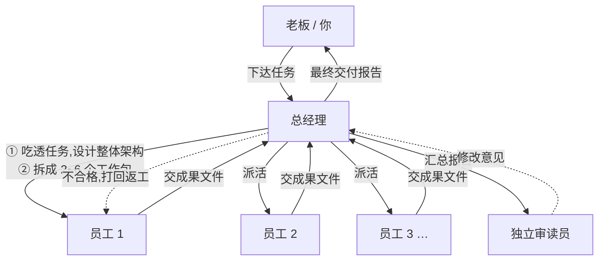

# AI 总经理团队 (AI GM Team)

> 你只当老板:下达一个任务,AI 总经理替你拆解架构、分工派活、验收返工、汇总交付。

`general-manager-team` 是一个 ZCode 动态工作流(dynamic workflow):一位 AI 总经理带领一个 AI 员工团队协作完成任务。你不需要管理任何 AI,只需要像对总经理下达任务一样说一句话,然后看进度、收报告。

  

## 它怎么工作



- **总经理负责制**:规划、派活、验收、汇总由同一位总经理负责,全程上下文连贯。
- **员工真实分工**:每名员工拿到的是「老板的任务 + 整体架构 + 自己的工作包 + 同事在做什么」,成果写成独立文件,互相衔接。
- **审核动真格**:总经理逐个打开员工成果文件验收,不合格的打回原员工返工(轮数有上限,不会无限循环)。
- **新鲜眼睛**:交付前,一位从未参与项目的**独立审读员**冷读报告、抽查成果,意见交总经理逐条处理,避免「自己写自己夸」。
- **老板请示机制**:方向性取舍、花钱、超出任务范围的关键决策,总经理会停下来向老板请示,不擅自拍板。
- **诚实交付**:到达返工上限仍未达标的部分,报告里会如实标注「未完全达标」并列入遗留问题,不粉饰。

## 快速开始(3 步)

1. 安装并登录 [ZCode](https://zcode.ai) Desktop。
2. 安装本工作流:克隆或下载本仓库,把 `workflows/general-manager-team.dwf.ts` 复制到:
   - Windows:`%USERPROFILE%\.zcode\workflows\`
   - macOS / Linux:`~/.zcode/workflows/`

   > ZCode 用户捷径:也可以直接对 ZCode 说「帮我把 xxx/general-manager-team.dwf.ts 安装到我的工作流目录」,让 AI 替你完成。
3. 在 ZCode 对话里下达任务:

   ```
   用总经理团队:帮我做一份智能家居行业的竞品分析报告
   ```

   确认运行后,团队就开工了。

## 运行时你会看到

- **阶段进度**:拆解分工 → 员工并行执行 → 总经理审核 → 打回返工 → 独立审读 → 汇总交付
- **工作包看板**:每名员工实时状态(执行中 / 待审核 / 返工中 / 已通过 / 未达标)
- **成果文件**:每名员工的成果是工作区里一份独立 Markdown 文件,随时点开细看
- **最终交付**:《总经理交付报告》卡片 —— 任务结论、各部分成果与文件位置、遗留问题

## 参数

| 参数 | 类型 | 默认 | 说明 |
| --- | --- | --- | --- |
| `task` | string | 必填 | 老板交办给总经理的完整任务描述 |
| `maxRounds` | number | 2 | 审核返工轮数上限 |
| `maxWorkers` | number | 6 | 最多拆成几个工作包 |

## 适合什么任务

凡是能「分头做、再拼起来」的任务都适合:

- 调研与分析报告(行业、竞品、市场)
- 方案与策划(活动方案、商业计划、产品需求)
- 内容生产(系列文章、图文素材包)
- 软件功能开发(前后端分工、开发+测试)
- 数据整理与分析流水线

一句话能答的小事不必动用团队 —— 每名员工都是一次完整的智能体会话,任务越大越划算。

## FAQ

**Q:它是一个独立软件吗?**
不是。它是 ZCode 里的一份可复用工作流定义,由 ZCode 的多智能体引擎执行,零配置、零依赖。

**Q:员工之间怎么协作?**
总经理在派活时给每人定义了清晰的「衔接约定」;员工能看到彼此的目标;总经理交叉验收跨包衔接;最后由总经理统一拼装。

**Q:质量怎么保证?**
三道关:员工自验(涉及代码/数据先自己跑通)→ 总经理逐包验收打回 → 独立审读员冷读最终报告。

**Q:可以调整团队规模和严格程度吗?**
可以。运行时传 `maxWorkers` / `maxRounds`,或直接编辑工作流文件里的人数上限、角色设定(`GM_PERSONA` / `WORKER_PERSONA`)。

## Roadmap

- [ ] 行业模板包(电商运营团队 / 自媒体内容团队 / 财务记账团队)
- [ ] 跨任务项目档案(团队记忆:上次任务的成果可供下次复用)
- [ ] 代码任务的自动化验证门(编译 / 测试结果直接决定验收)
- [ ] 插件化一键安装

## License

[MIT](LICENSE) —— 欢迎自由使用、修改与分发;如果它帮到了你,欢迎给个 Star。
